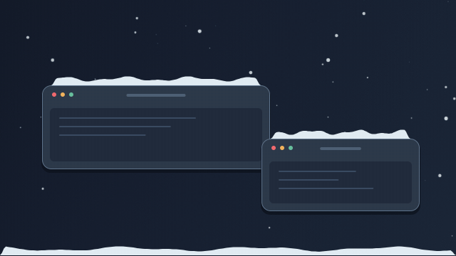
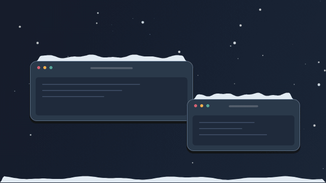
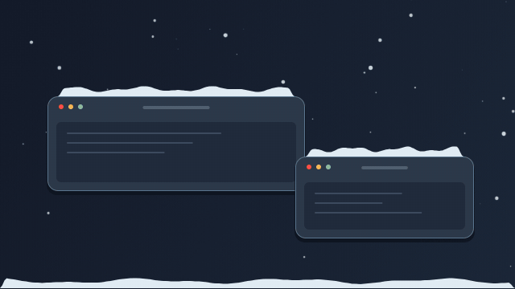
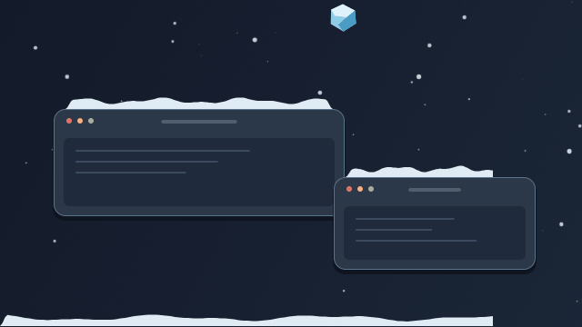
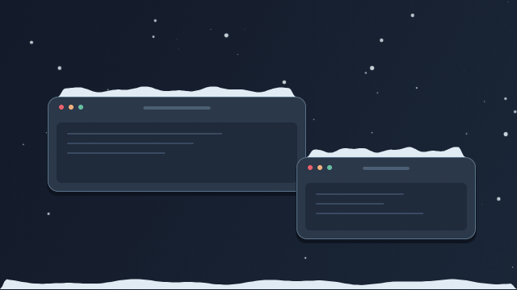
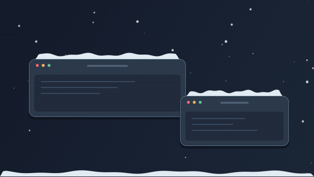
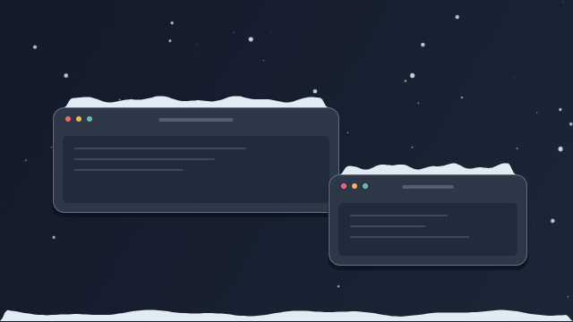
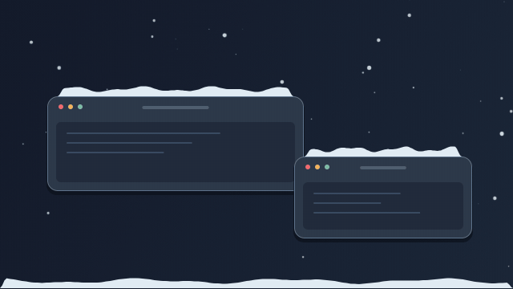
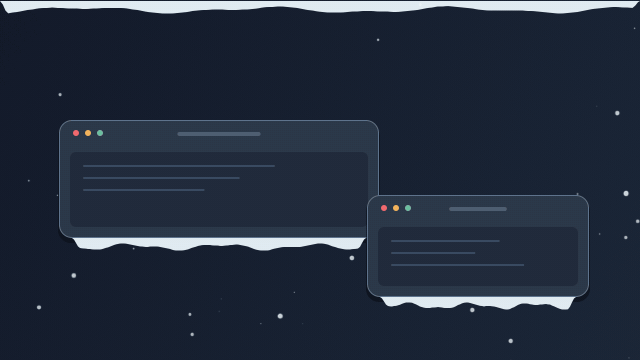
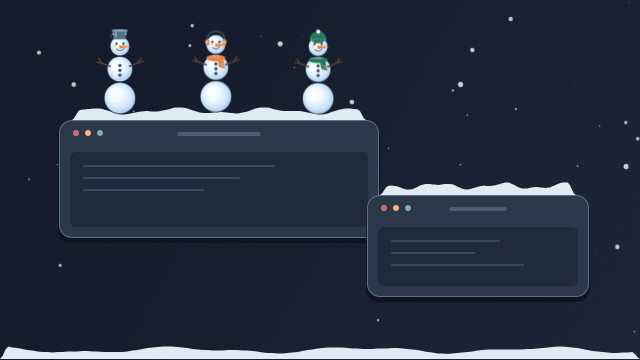

# Снегопад 1.0.1

Снег на рабочем столе macOS и Windows и на элементах сайта. Сугробы перемещаются вместе с поверхностью. При рывке часть снега подлетает и снова падает. Сместите снег курсором или зацепите сугроб движущимся окном, чтобы снег упал на поверхность ниже.

На рабочем столе сугроб перетаскиваемого окна осыпается в месте столкновения с боковой гранью другого окна.

Включите «Австралию» в меню или на панели демо, чтобы снег шёл вверх и оседал под нижними кромками. При переключении начинается новый снегопад. В режиме снежков можно собирать снег и складывать снежки в обоих направлениях.

Сугробы оставляют скруглённые углы свободными. В macOS отступ для системных окон оценивается по поколению оформления. В Windows он зависит от версии системы, масштаба и размеров окна. Виджет читает верхние или нижние радиусы CSS элемента. [Оформление AppKit](https://developer.apple.com/videos/play/wwdc2025/310/), [скругления Windows 11](https://learn.microsoft.com/en-us/windows/apps/design/signature-experiences/geometry).

## Демонстрация macOS

В этих GIF приложение рисует снег и персонажей поверх демонстрационных окон. Чтобы открыть ролик крупнее, нажмите на него.

| Снег на окнах | Санта и подарки |
| --- | --- |
| [](docs/demo/moving-window.gif) | [](docs/demo/santa.gif) |

| Снегоочиститель | Удар и погоня |
| --- | --- |
| [](docs/demo/plow.gif) | [](docs/demo/chase.gif) |

<details>
<summary>Другие эффекты уборки, «Австралия» и снеговики</summary>

| Уборка лопатой | Порыв ветра |
| --- | --- |
| [](docs/demo/shovel.gif) | [](docs/demo/wind.gif) |

| Лавина | Оттепель |
| --- | --- |
| [](docs/demo/avalanche.gif) | [](docs/demo/thaw.gif) |

| «Австралия» | Снеговики |
| --- | --- |
| [](docs/demo/australia.gif) | [](docs/demo/snowmen.gif) |

</details>

## macOS

Откройте приложение и нажмите снежинку в строке меню. В меню можно изменить интенсивность и ветер или поставить снег на паузу. В меню «Очистить снег» выберите эффект или мгновенный сброс. Автоочистка по умолчанию запускается через 15 минут активного снегопада и по очереди включает разные эффекты. Очистка сбрасывает накопление на всех рабочих столах. Свежий снег продолжает идти во время эффекта.

В меню снежинки откройте «Настройки…» (`⌘,`). Там можно изменить снегопад, выбрать эффект уборки, задать интервал полётов Санты или запустить полёт сразу. По умолчанию Санта пролетает каждые 5 минут активного снегопада. Санта и олени меняют позы по кадрам. Подарки падают на кромки и отскакивают, а из подходящих сугробов вырастают снеговики.

Чтобы посмотреть Санту и три сцены уборки подряд, закройте запущенный «Снегопад» и выполните из корня проекта `open -g build/Снегопад.app --args --demo`. Для демонстрации приложение заполнит видимые сугробы. После показа продолжится обычный снегопад.

В режиме снежков протащите снежок по сугробу и отпустите над краем окна. Чтобы нарастить поставленный снежок, снова подхватите его левой кнопкой и прокатите по снегу. Снежки сверху двигаются вместе с нижним. Из трёх снежков получается снеговик с морковкой, пуговицами и одним из нескольких головных уборов. У некоторых снеговиков есть шарф. Правый клик разбивает снежок или снеговика. Чтобы выйти из режима снежков, кликните по окну или нажмите Esc.

По умолчанию после разрушения одного снеговика у оставшихся на 10 секунд краснеют глаза, и они бросают снежки в курсор. Откройте сворачиваемый раздел «Злой режим» в настройках, чтобы задать порог от 1 до 20 снеговиков или изменить длительность. Длительность 0 секунд отключает режим.

Из корня проекта соберите приложение командой `./macos/build.sh`. Сборка поддерживает Apple Silicon и Intel и нацелена на macOS 12 и новее. Для локальной сборки применяется подпись ad hoc. Для распространения через прямую загрузку задайте переменную `SNOW_SIGNING_IDENTITY` с именем сертификата Developer ID Application, затем отправьте сборку на нотарификацию Apple. [Документация Apple](https://developer.apple.com/documentation/security/notarizing-macos-software-before-distribution).

## Windows

Управление находится в меню снежинки в трее. Если значок скрыт, разверните область уведомлений. Приложение работает с обычными правами пользователя. Сборка предназначена для Windows x64.

- На Windows запустите `.\windows\build.ps1` из терминала Visual Studio с установленным Windows SDK.
- На Mac или Linux запустите `./windows/cross-build.sh` с установленным Zig. Кросс-сборка проверена на Zig 0.17.1.
- Результат обеих команд находится в `build/windows/SnowOverlay.exe`.

Для выпуска через Microsoft Store подготовьте MSIX с идентификатором и издателем из Partner Center. Store подписывает пакет после сертификации. Для распространения EXE напрямую подпишите выпуск доверенным сертификатом. SmartScreen может показать предупреждение для новой сборки даже при действительной подписи. [Документация Microsoft](https://learn.microsoft.com/en-us/windows/apps/package-and-deploy/smartscreen-reputation).

Перед публичным выпуском проверьте запуск финальной сборки на Windows 11 с включённым Smart App Control и с актуальными определениями Microsoft Defender. При обнаружении файла как вредоносного отправьте финальную сборку поставщику защиты для проверки. [Тестирование Smart App Control](https://learn.microsoft.com/en-us/windows/apps/develop/smart-app-control/test-your-app-with-smart-app-control), [проверка файла Microsoft](https://www.microsoft.com/en-us/wdsi/filesubmission).

## Виджет для сайта

Скопируйте `web/snow.mjs` в папку со статическими файлами сайта. Укажите атрибут `data-snow-surface` на элементах, где снег должен оседать.

```html
<section id="winter" style="position: relative; overflow: hidden">
  <article data-snow-surface>Ваш контент</article>
</section>
<script type="module">
  import { mountSnow } from "/assets/snow.mjs";
  const snow = mountSnow({ root: document.querySelector("#winter"), intensity: "steady", wind: 0 });
</script>
```

Для эффекта на всей странице вызовите `mountSnow()`. Для отдельного блока используйте позиционированную область и разместите прокручиваемый контент во вложенном элементе. Параметр `surfaces` принимает CSS-селектор. Контроллер предоставляет `setIntensity()`, `setWind()`, `setInteractive()`, `setAustralia()`, `clear()`, `pause()`, `resume()` и `destroy()`. Чтобы начать с обратной гравитации, передайте `australia: true`. Поддерживаются режимы `light`, `steady` и `blizzard`. Ветер задаётся числом от −1 до 1. По умолчанию виджет учитывает системную настройку уменьшения движения.

Если сайт перетаскивает отмеченный элемент, вызовите `snow.refreshSurfaces()` после изменения его позиции. Виджет обновит кромку при отрисовке ближайшего кадра.

Для запуска демонстрации выполните из корня проекта `python3 -m http.server 8000 --bind 127.0.0.1 --directory web`. Откройте [демонстрацию](http://127.0.0.1:8000/) в браузере.

## Проверки

- Симуляция. Выполните `mkdir -p build`, затем `cc -std=c17 -Icore core/snow.c tests/core.c -lm -o build/test-core` и `./build/test-core`.
- macOS. Выполните `xcrun clang -fobjc-arc -Icore core/snow.c tests/macos-render.m -framework AppKit -framework CoreGraphics -framework QuartzCore -o build/test-macos-render`, затем `./build/test-macos-render` в активном графическом сеансе.
- Браузер. В среде с Node.js, Playwright и Chromium выполните `node tests/browser.cjs`. Переменные `PLAYWRIGHT_MODULE` и `CHROMIUM_BIN` позволяют указать уже установленные инструменты.
- Настольные приложения. Проверьте меню, клики по окну под снегом, движение сугроба с окном, режим снежков, оба направления снегопада, полноэкранный режим и разные масштабы на нескольких мониторах.

[Спецификация версий 1.0.1 и 1.0.0](SPEC.md).
